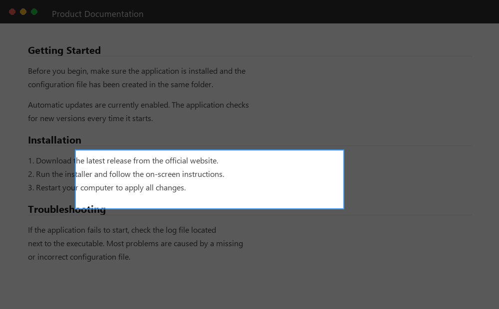
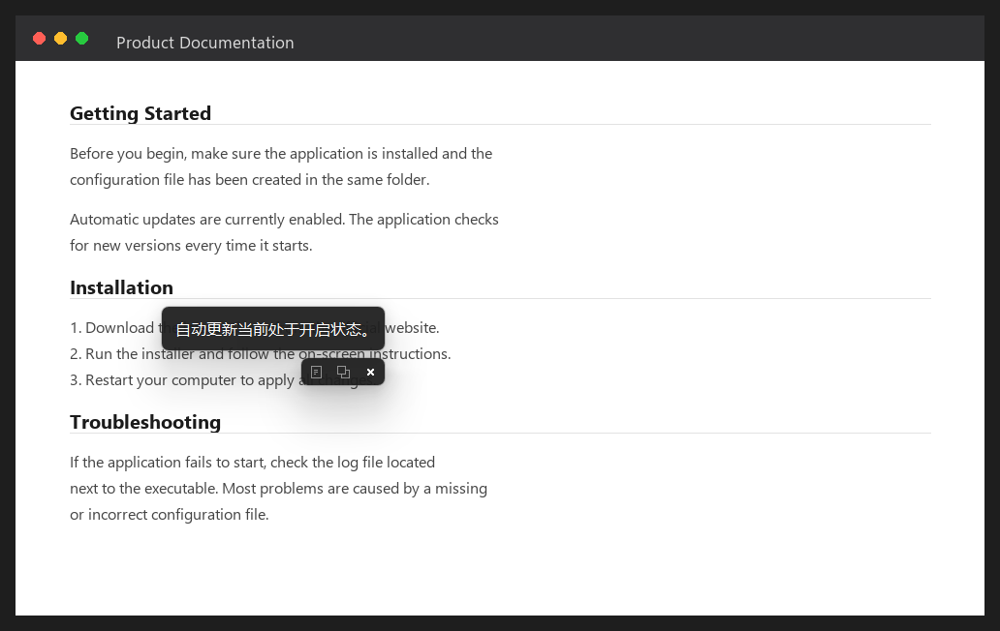
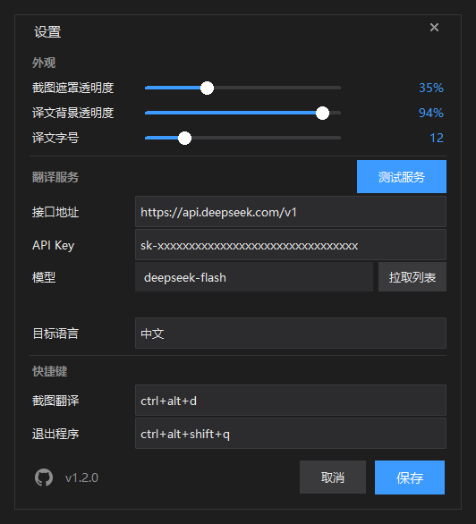

# 截图翻译

**中文** · [English](README.en.md)

按一下快捷键，框选屏幕上的一块区域，译文就直接浮在那块地方。

它没有主窗口、没有登录、没有广告、没有历史记录。启动之后桌面上什么都没有，只在任务栏留一个小图标；只有按下快捷键的那一刻，译文才会浮出来。

## 效果

框选时整个屏幕暗下来，选中的那块保持原样：



松开鼠标，译文直接浮在框选的位置上。右下角三个图标分别是复制原文、复制译文、关闭：



所有配置都在托盘图标的设置窗口里改，拖滑块就行：



---

## 一、最快上手（用已经打好的 exe）

1. 找到 `dist\截图翻译.exe`，把它复制到一个**你自己新建的文件夹**里，比如 `D:\截图翻译\`。
   不要放在桌面或 C 盘的程序目录里，否则 Windows 可能不让它写配置文件。
2. **先运行一次**，然后关掉它（它会自动在同一个文件夹里生成 `config.json`）。
3. 用记事本打开 `config.json`，把 `api_key` 那一行填上你自己的 API Key：

   ```json
   "api_key": "sk-你自己的key",
   ```
   同时确认 `api_base_url` 和 `model` 是对的（往下看第 4 节有例子）。
4. 保存文件，再双击 `截图翻译.exe`。这次它就安静地在后台待命了。
5. 按下 **Ctrl + Alt + D**，屏幕变暗，拖鼠标框住要翻译的内容，松手。
6. 选中的位置会浮出一层深色半透明的译文。看完按 **Esc**，它就消失了。
7. 想彻底关掉程序，按 **Ctrl + Alt + Shift + Q**。

> 双击 exe 之后桌面上不会出现任何窗口，只在任务栏右下角的通知区域多一个小图标 —— 这是**正常的**。
> 直接按快捷键用就行，那个托盘图标平时不用管它。

### 快捷键

| 按键 | 作用 |
| --- | --- |
| `Ctrl + Alt + D` | 进入截图翻译 |
| `Ctrl + Alt + Shift + Q` | 退出程序 |
| `Esc` | 关掉译文浮层；如果正在截图，则是取消这次截图 |
| 在浮层上点鼠标右键 | 关掉译文浮层 |
| 在截图遮罩上点鼠标右键 | 取消这次截图 |
| 按住浮层拖动 | 把译文面板挪到别的位置 |

快捷键可以在 `config.json` 里改（见第 4 节）。

### 浮层长什么样

浮层是一块深灰半透明的小面板，四角带 Win11 的小圆角，**大小贴合译文本身的宽高**，不会照搬你框选的区域大小：

- 译文短，面板就小，紧贴着框选位置的左上角
- 译文长，面板先横向变宽，宽到上限才开始换行、向下变高
- 实在太长时会自动缩小字号，保证整段都能看见、不滚动、不占满屏幕
- 面板上只显示译文，不显示原文

**按住面板任意位置可以把整个浮层拖到别处**，鼠标会变成四向箭头。拖过之后它就不会再自己跳回原位了。

### 浮层右下角的三个图标

| 图标 | 鼠标移上去显示 | 作用 |
| --- | --- | --- |
| 📄 一张纸 | 复制文字 | 把识别到的原文复制到剪贴板 |
| ⧉ 两个方框 | 复制翻译 | 把中文译文复制到剪贴板 |
| ✕ 叉（白色） | 关闭 | 关掉浮层 |

点前两个图标时，图标会闪一下变亮表示已经复制了，不会弹任何提示框。鼠标悬停时图标会变亮；关闭图标平时就是白色（悬停变红），便于一眼找到。

悬停约 0.4 秒会在**面板外面**（下方）浮出一行小提示，不会挡住译文。

除了点 ✕，按 `Esc` 或者**在浮层上点鼠标右键**也能关掉它。

### 遮罩的淡入淡出

按快捷键时，屏幕不是"啪"一下变黑，而是用大约 0.13 秒平滑地暗下来；松手或取消时再用约 0.05 秒平滑地亮回去。这样反复截图不会有闪烁感，眼睛舒服些。

### 托盘图标

程序启动后，任务栏右下角的通知区域（可能要点小箭头展开）会有一个图标：

- **双击它** → 打开设置窗口
- **右键它** → 菜单：打开设置 / 截图翻译 / 退出

### 设置窗口

托盘图标右键 → 打开设置，就能改这些东西，**改完点保存立刻生效，不用重启**：

| 分组 | 能改什么 |
| --- | --- |
| 外观 | 截图遮罩透明度、译文背景透明度、译文字号（都是拖动滑块） |
| 接口 | 接口地址、API Key、模型名、目标语言 |
| 快捷键 | 截图翻译、退出程序 |

这些改动会写回 `config.json`，所以你也可以直接编辑文件，两种方式等价。

---

## 二、从源码运行（想改代码或者自己打包的人）

需要 **Python 3.10 或更高版本**。没装的话去 <https://www.python.org/downloads/> 下载，
安装时**务必勾选** `Add python.exe to PATH`。

在本文件夹里打开命令行（在文件资源管理器的地址栏输入 `cmd` 然后回车），依次执行：

```bat
pip install -r requirements.txt
python main.py
```

`python main.py` 之后同样没有任何窗口，按 `Ctrl + Alt + D` 开始用。

想用独立的虚拟环境（推荐，不会污染系统 Python）：

```bat
python -m venv .venv
.venv\Scripts\pip install -r requirements.txt
.venv\Scripts\python main.py
```

---

## 三、自己打包成 exe

双击 **`build.bat`** 就行。它会自动装好 PyInstaller（如果还没有），然后生成：

```text
dist\截图翻译.exe
```

打包大约需要 1～3 分钟，完成后窗口会停住让你看结果。

也可以手动执行：

```bat
pip install pyinstaller
pyinstaller --noconfirm --clean --onefile --noconsole --name 截图翻译 --icon assets\icon.ico main.py
```

打包出来的 exe 第一次运行会在它自己的旁边生成 `config.json`，改那个文件即可，不用重新打包。

---

## 四、配置文件 `config.json`

程序**必须**和 `config.json` 放在同一个文件夹里。文件不存在时程序会自动生成一份默认的。

| 字段 | 默认值 | 说明 |
| --- | --- | --- |
| `api_base_url` | `https://api.openai.com/v1` | 接口地址，末尾通常带 `/v1` |
| `api_key` | 空 | **必填**。留空时按快捷键，浮层会提示你去填 |
| `model` | `gpt-4o-mini` | 多模态模型名 |
| `hotkey` | `ctrl+alt+d` | 截图翻译快捷键 |
| `exit_hotkey` | `ctrl+alt+shift+q` | 退出程序快捷键 |
| `target_language` | `中文` | 翻译成什么语言 |
| `mask_opacity` | `0.35` | 截图遮罩的亮度，越小屏幕越暗 |
| `overlay_opacity` | `0.88` | 译文浮层的不透明度，想更实就调到 `0.95` |
| `overlay_bg` | `#1e1e1e` | 浮层背景色 |
| `overlay_fg` | `#ffffff` | 浮层文字颜色 |
| `font_size` | `12` | 浮层字号（磅） |
| `request_timeout` | `30` | 接口超时秒数 |

改完保存，**下次启动生效**。字段写错不会让程序崩溃，程序会自动退回默认值并在日志里记一笔。

### 换一个翻译服务

只要接口是 OpenAI 兼容格式（`/chat/completions`）就能用。几个例子：

```jsonc
// OpenAI 官方
{ "api_base_url": "https://api.openai.com/v1", "model": "gpt-4o-mini" }

// DeepSeek（必须用带 vision 的档位，纯文本档位会拒绝图片）
{ "api_base_url": "https://api.deepseek.com/v1", "model": "deepseek-flash" }

// 阿里通义千问（百炼）
{ "api_base_url": "https://dashscope.aliyuncs.com/compatible-mode/v1", "model": "qwen-vl-max" }

// 智谱 GLM
{ "api_base_url": "https://open.bigmodel.cn/api/paas/v4", "model": "glm-4v-plus" }

// 本地 Ollama（需要先 ollama pull 一个视觉模型）
{ "api_base_url": "http://127.0.0.1:11434/v1", "api_key": "ollama", "model": "llava" }
```

用的是多模态模型，**必须选能看图的模型**。几个常见的选择：

| 服务商 | 模型名 | 说明 |
| --- | --- | --- |
| DeepSeek | `deepseek-flash` | 2026-08 上线的视觉档位。`deepseek-reasoner` 等纯文本档位**不支持图片** |
| OpenAI | `gpt-4o-mini` | |
| 阿里百炼 | `qwen-vl-max` | |
| 智谱 | `glm-4v-plus` | |
| 本地 | `llava` / `qwen2-vl` | 用 Ollama 跑，不联网 |

---

## 五、怎么验证它工作正常

按顺序做一遍，每步都该出现括号里描述的现象：

1. **后台运行** —— 双击 exe，桌面上没有出现任何窗口，任务栏右下角通知区多了一个小图标。（正确）
2. **托盘菜单** —— 右键那个小图标，应该弹出「打开设置 / 截图翻译 / 退出」。（对）
3. **设置窗口** —— 点「打开设置」，出来一个深色窗口，能拖滑块改透明度、能改 API Key。（对）
4. **截图框选** —— 按 `Ctrl + Alt + D`。屏幕整体变暗、画面静止，鼠标变成十字。（对）
5. **拖拽** —— 按住左键拖出一个矩形框。框住的区域恢复原来的亮度，框外是暗的。（对）
6. **松手** —— 松开左键，变暗的遮罩立刻消失。（对）
7. **出译文** —— 刚才框的位置浮出一块深色半透明面板，先显示「翻译中…」，一两秒后变成中文译文。（对）
8. **复制原文** —— 点浮层右下角**第一个图标**（一张纸）。找个地方按 `Ctrl + V` 粘贴，应该是图片里的原文。（对）
9. **复制译文** —— 点**第二个图标**（两个方框），粘贴出来的是中文译文。（对）
10. **拖动浮层** —— 按住浮层文字部分拖一下，整个面板跟着鼠标走，松手后停在新位置。（对）
11. **关闭** —— 按 `Esc`，或者点右下角**第三个图标**（✕），浮层消失，桌面恢复干净，但程序还在后台。（对）
12. **再来一次** —— 再按 `Ctrl + Alt + D`，一切正常重复。（对）
13. **退出** —— 按 `Ctrl + Alt + Shift + Q`，或者托盘右键 →「退出」，程序结束、托盘图标消失。（对）

### 出问题了看哪里

程序没有窗口，所以出错信息都写进日志文件：

```text
screenshot-translator.log     （就在 exe / main.py 旁边）
```

它会记录启动、热键注册、每次翻译的结果和完整的错误堆栈。

几个常见情况：

| 现象 | 原因 |
| --- | --- |
| 浮层显示“请先在 config.json 中填写 api_key” | `api_key` 是空的，去填一下 |
| 浮层显示“API Key 无效” | key 填错了，或者复制时带了空格 |
| 浮层显示“模型名或 api_base_url 不正确” | 模型名拼错，或者接口地址少了 `/v1` |
| 浮层显示“网络连接失败” | 网络不通，或者接口地址写错；用 OpenAI 官方接口一般需要代理 |
| 浮层显示“请求超时” | 网络慢，把 `request_timeout` 调大一点 |
| 按快捷键没反应 | 快捷键被别的软件占用了（有道词典、QQ、截图工具都爱占 `Ctrl+Alt+D`）。改 `config.json` 里的 `hotkey`，重启程序 |
| 程序启动不了 / 双击没反应 | 看日志。也可能是已经有一个实例在跑——程序不允许开两个 |

> 程序同一时间只允许运行一个。重复双击不会有第二个窗口，第二个会直接退出。

---

## 六、它是怎么做的

```text
screenshot-translator\
├─ main.py             入口：全局快捷键、事件循环、退出热键
├─ config.py           读取、校验、保存 config.json
├─ screenshot.py       截图遮罩、鼠标框选、裁出选区
├─ translator.py       调用多模态模型、解析 JSON、把错误翻译成人话
├─ overlay.py          译文浮层：文字、三个图标按钮、拖动、自适应大小
├─ settings_window.py  设置窗口（深色、无边框、自绘滑块）
├─ tray.py             托盘图标和右键菜单
├─ icons.py            图标绘制（浮层按钮 + 托盘图标）
├─ winutil.py          Windows 窗口小工具（顶层 HWND、Win11 圆角）
├─ config.json         配置文件
├─ requirements.txt    依赖清单
├─ build.bat           一键打包
├─ build.py            打包脚本本体
├─ assets\icon.ico     程序图标
└─ dev\                开发时用的自测脚本（普通使用用不到）
```

工作流程：

1. `keyboard` 在后台监听全局快捷键，回调里只往队列丢一个事件（Tk 不是线程安全的，不能直接操作界面）。
2. 主线程从队列取到事件，用 `mss` 抓一张整个虚拟屏幕（含所有显示器）的图。
3. 弹一个无边框窗口铺满整块虚拟屏，显示这张**压暗后**的截图——所以看起来像屏幕冻结了。框选区域恢复原始亮度。
4. 松手后把选区裁出来，转成 PNG 再转 Base64，交给 OpenAI 兼容接口。
5. 请求在子线程里跑，返回的 JSON 解析出原文和译文，再交回主线程更新浮层。
6. 浮层自己算尺寸、贴合文字、支持拖动；关闭后程序继续在后台等下一次快捷键。
7. 托盘图标跑在 `pystray` 自己的线程里，菜单回调同样只往队列丢事件；设置窗口改完配置会立刻重新注册快捷键。

关于“半透明遮罩”的实现：窗口本身其实是不透明的，显示的是压暗到 35% 亮度的截图。
这样既能让画面真正“冻住”（不会拍到正在变化的画面），又达到了遮罩变暗的视觉效果。

---

## 七、不做什么

刻意**没有**做这些东西，避免变成一个臃肿的软件：

- 主窗口（程序启动后桌面上是空的，只有任务栏一个托盘图标）
- 登录、账号、会员、广告、统计、自动更新
- 历史记录、翻译引擎切换列表
- “复制成功”之类的弹窗
- 浮层上的多余元素——只有译文和右下角三个图标

设置窗口和 `config.json` 是等价的：设置窗口只是帮你改这个文件，不会引入额外的状态。
你也可以直接编辑 `config.json`，两种方式改的是同一份配置。

---

## 八、开源协议

[MIT](LICENSE) —— 随便用、随便改、随便商用，保留版权声明、作者不担责。
